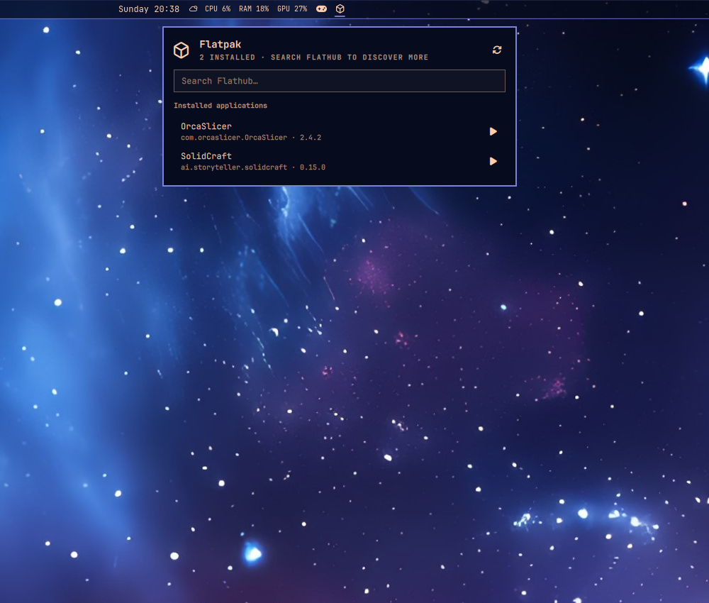

# xmanig.flatpak

An Omarchy center-bar browser for installed Flatpak applications and Flathub.



## Features

- Lists installed Flatpak applications.
- Launches installed apps with `flatpak run`.
- Searches Flathub through the local `flatpak` CLI.
- Installs selected Flathub apps after an explicit confirmation step.
- Uninstalls installed apps after an explicit “100% sure” confirmation step.
- Installs to the user Flatpak installation with `--user`; no sudo prompt is
  triggered by the plugin.
- Uninstalls from the installation where each app is installed.
- Refreshes installed applications every 30 seconds.

## Install

```sh
omarchy plugin add https://github.com/xmanig/xmanig-omarchy-flatpak --enable
omarchy bar move xmanig.flatpak --section center
omarchy restart shell
```

The plugin lands at `~/.config/omarchy/plugins/xmanig.flatpak/`.

## Controls

- Click the center-bar Flatpak package icon to open the panel.
- Leave search empty to browse installed applications.
- Type at least two characters to search Flathub.
- Click the play button to launch an installed app.
- Click the download button, review the application ID, then confirm before
  installing it.
- Click the trash button, verify the application name and ID, then confirm
  only if you are 100% sure before uninstalling it.
- Press `r` or use the refresh button to reload installed apps.
- Press `Esc` to clear the search, then press it again to close the panel.

The search and install operations use the configured `flathub` remote. Flatpak
must be installed and the `flathub` remote must be configured:

```sh
flatpak remote-add --if-not-exists \
  flathub https://dl.flathub.org/repo/flathub.flatpakrepo
```

## Development

Validate locally with:

```sh
omarchy plugin validate .
node --check Model.js
```

The plugin is user-owned and does not modify `/usr/share/omarchy`.
